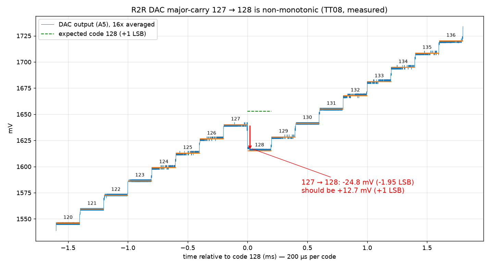

<!---

This file is used to generate your project datasheet. Please fill in the information below and delete any unused
sections.

You can also include images in this folder and reference them in the markdown. Each image must be less than
512 kb in size, and the combined size of all images must be less than 1 MB.
-->

## How it works

A simple 8 bit R2R DAC. Driven externally or by an digitally generated sine waveform generator.

3.3v output is achieved with level shifting drivers. The TT08 version didn't have large enough drivers, which resulted in a non-monotonic output.

This version makes the output N and Pfets 5x larger (PMOS W=45um nf=15, NMOS W=15um nf=5) to get a monotonic output.

## How to test

### Drive externally

Set the `external data` input high to provide the DAC with external data.

Then drive the 8 inputs and observe the analog output.

### Drive with internal sawtooth wave generator

Set the `external data` input low to enable the sine generator.
A sine wave should be seen on the analog output. Everytime the sine counter is at 0, digital output 0 should go high for one clock.

To change the frequency, set the inputs and then raise the 'load divider' input.

## External hardware

An oscilloscope to measure the output voltage on analog pin 0.

On the TT08 (RP2040) demoboard, `ua[0]` (DAC output) comes out on analog header **A5**
(website pin "K", internal index 5).

## Hardware-in-the-loop test

`test/test_hil.py` drives the DAC codes directly from the RP2040 (external data mode) and
uses a Keysight HD304MSO to measure the static transfer function (monotonicity, DNL, INL,
offset, gain) plus full-scale step response and the 127→128 major-carry glitch.
See the docstring at the top of that file for wiring and usage.

Measured on TT08 silicon: offset 3.7 mV, full scale 3.242 V, LSB 12.70 mV, INL 1.9 LSB.
The DAC is not monotonic at the major carries. 127→128 steps down by 24.8 mV (−1.95 LSB),
and 63→64 and 191→192 each step down by about 5.7 mV.

## Test

